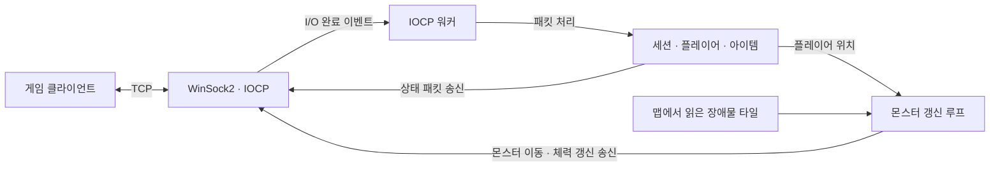

# EVADO | IOCP 멀티플레이어 게임 서버

Windows용 실시간 멀티플레이어 게임 서버입니다. C++과 WinSock2의 I/O Completion Ports(IOCP)로 클라이언트 연결과 패킷을 처리하고, 별도 게임 루프에서 몬스터의 추적과 공격을 계산합니다. 플레이어, 몬스터, 아이템의 상태 변경을 패킷으로 전달해 여러 클라이언트의 게임 상태를 맞춥니다.

## 구현 하이라이트

| 기능 | 구현 내용 |
| --- | --- |
| 비동기 TCP 네트워크 | `AcceptEx`, `WSARecv`, `WSASend`를 사용하고, IOCP 워커가 접속·수신·송신 완료 이벤트를 처리합니다. |
| 멀티플레이어 상태 동기화 | 로그인 시 신규·기존 플레이어 정보를 교환합니다. 맵 로딩이 끝나면 아이템과 몬스터의 초기 상태를 보내고, 플레이 중에는 위치·방향·애니메이션 변경을 전달합니다. |
| 몬스터 추적 AI | 바이너리 맵 데이터로 장애물 타일을 구성합니다. 거미 몬스터는 감지 범위 안의 가장 가까운 플레이어를 4방향 A*로 추적하고, 공격 범위와 재사용 대기 시간에 따라 공격합니다. |
| 아이템과 상점 | 아이템 생성과 위치·방향 변경을 동기화합니다. 서버가 상점 구매·판매를 처리해 세션의 재화와 보유 아이템을 갱신하고, 거래 결과를 클라이언트에 응답합니다. |

## 서버 구조



### 네트워크 I/O와 게임 루프

워커는 `GetQueuedCompletionStatus`에서 완료 이벤트를 꺼내고, 수신 패킷을 길이와 타입에 따라 처리합니다. 세션 목록은 뮤텍스로 보호하며, 브로드캐스트는 목록에서 수신 대상을 모은 뒤 잠금을 풀고 송신합니다. 별도 몬스터 루프는 직전 반복 이후 경과 시간과 플레이어 위치를 사용해 몬스터를 갱신합니다. [main.cpp](evado_server_IOCP/evado_server_IOCP/main.cpp) · [WorkerThread.cpp](evado_server_IOCP/evado_server_IOCP/WorkerThread.cpp) · [패킷 정의](evado_server_IOCP/evado_server_IOCP/pch.h)

### A* 경로 재사용과 상태 갱신

서버 시작 시 맵 오브젝트의 XZ 좌표를 격자로 변환해 벽이나 선반이 있는 타일을 이동 불가로 표시합니다. A*는 이동 가능한 상하좌우 타일을 맨해튼 거리 휴리스틱으로 탐색합니다. 몬스터는 목표 타일이 바뀌거나 경로를 소진할 때 다시 탐색하고, 기존 경로를 따라가는 동안에는 계산한 경로를 재사용합니다. 위치나 행동 상태가 바뀌면 몬스터 이동 패킷을 전송합니다. [맵 로딩](evado_server_IOCP/evado_server_IOCP/WorkerThread.cpp#L605) · [Monster.cpp](evado_server_IOCP/evado_server_IOCP/Monster.cpp) · [MonsterManager.cpp](evado_server_IOCP/evado_server_IOCP/MonsterManager.cpp)

## 빌드 및 실행

- **환경** Windows x64, Visual Studio 2022의 **C++를 사용한 데스크톱 개발** 워크로드, MSVC v143, Windows SDK
- **기술 스택** C++, WinSock2, Windows IOCP, DirectXMath, ODBC

1. Visual Studio에서 [evado_server_IOCP.sln](evado_server_IOCP/evado_server_IOCP.sln)을 열고 `x64` / `Release` 구성으로 빌드합니다.
2. 저장소 루트에서 PowerShell을 열고 아래 명령으로 서버를 실행합니다. 서버는 작업 디렉터리의 `Model/`에서 맵 데이터를 읽습니다.

   ```powershell
   Set-Location .\evado_server_IOCP\evado_server_IOCP
   ..\x64\Release\evado_server_IOCP.exe
   ```

3. 게임 플레이를 확인하려면 [패킷 정의](evado_server_IOCP/evado_server_IOCP/pch.h)와 호환되는 별도 클라이언트를 서버의 TCP `3000` 포트에 연결합니다.

ODBC 연결 및 연결 풀 코드는 포함되어 있으며, 기본 실행에서는 서버 초기화 시점의 DB 연결이 비활성화되어 있습니다. [DBConnect.cpp](evado_server_IOCP/evado_server_IOCP/DBConnect.cpp) · [DBConnectPool.cpp](evado_server_IOCP/evado_server_IOCP/DBConnectPool.cpp) · [서버 초기화](evado_server_IOCP/evado_server_IOCP/main.cpp#L39)
